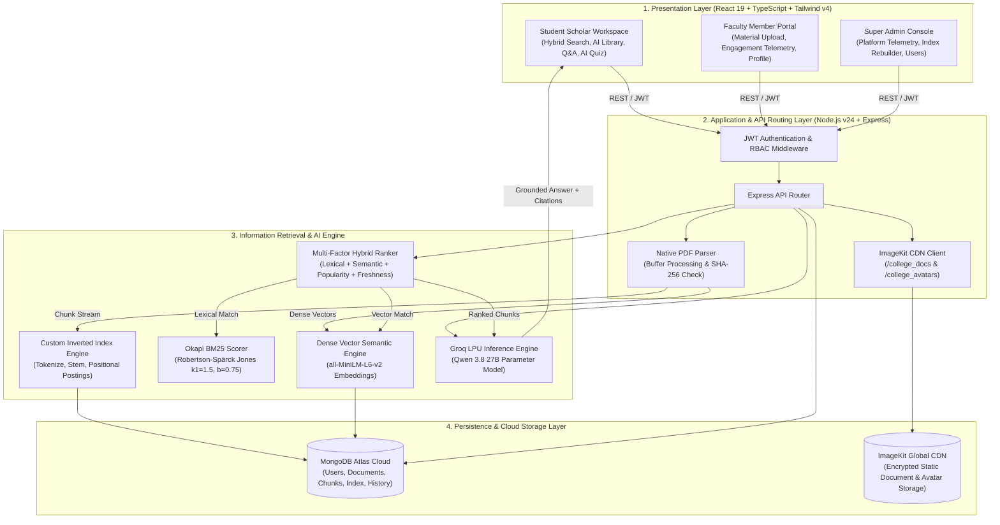
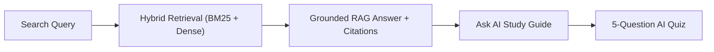
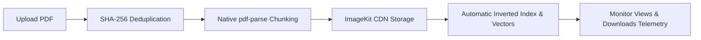
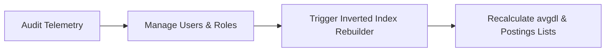

# 🎓 AI-Powered College Search & Intelligence Platform
### *An Enterprise-Grade Campus Knowledge Engine combining Hybrid Information Retrieval (BM25 + Dense Semantic Vectors) with Grounded Retrieval-Augmented Generation (RAG)*

[](https://react.dev/)
[](https://tailwindcss.com/)
[](https://nodejs.org/)
[](https://www.mongodb.com/atlas)
[](https://imagekit.io/)
[](https://groq.com/)
[-brightgreen)](#)

---

## 📑 Quick Navigation
* [🌟 Project Overview & Vision](#-project-overview--vision)
* [⚡ Key System Highlights & Core Innovations](#-key-system-highlights--core-innovations)
* [🏗️ End-to-End System Architecture](#️-end-to-end-system-architecture)
* [🧮 Information Retrieval (IR) & AI Mathematics](#-information-retrieval-ir--ai-mathematics)
* [🚀 Comprehensive Feature Breakdown](#-comprehensive-feature-breakdown)
  * [1. Sub-Second Multi-Factor Hybrid Search](#1-sub-second-multi-factor-hybrid-search)
  * [2. Grounded RAG with Clickable Page Citations](#2-grounded-rag-with-clickable-page-citations)
  * [3. Document AI Tutor & 3-Page Master Study Guide](#3-document-ai-tutor--3-page-master-study-guide)
  * [4. Interactive In-Document Grounded Q&A Assistant](#4-interactive-in-document-grounded-qa-assistant)
  * [5. Automated Formative AI Quiz Generator](#5-automated-formative-ai-quiz-generator)
  * [6. Native PDF Ingestion, Parsing & ImageKit CDN](#6-native-pdf-ingestion-parsing--imagekit-cdn)
  * [7. Faculty Engagement Telemetry (Views & Downloads)](#7-faculty-engagement-telemetry-views--downloads)
  * [8. Custom Profile Photos & Academic Monogram Badges](#8-custom-profile-photos--academic-monogram-badges)
  * [9. Super Admin Control Center & Real-Time Index Rebuilder](#9-super-admin-control-center--real-time-index-rebuilder)
* [👥 Role-Based Access Control (RBAC) Matrix](#-role-based-access-control-rbac-matrix)
* [🔄 End-to-End User Workflows](#-end-to-end-user-workflows)
* [📡 RESTful API Endpoints Specification](#-restful-api-endpoints-specification)
* [🛠️ Technology Stack](#️-technology-stack)
* [💻 Setup & Installation Guide](#-setup--installation-guide)
* [📂 Project Directory Structure](#-project-directory-structure)
* [📖 Academic Thesis & Publications](#-academic-thesis--publications)

---

## 🌟 Project Overview & Vision

In traditional university campuses, verified academic learning materials—lecture presentations, semester syllabi, previous year examination question papers (PYQs), placement notices, and lab guides—are severely fragmented across informal WhatsApp groups, obscure Google Drive links, and unindexed local drives.

Traditional college search portals only search file titles (`LIKE '%filename%'`). If an important theorem or placement eligibility rule is buried inside slide 14 of an obscurely titled file (`Unit3_DB_Notes_final.pdf`), traditional search tools fail to find it. Furthermore, public AI chatbots (such as ChatGPT) hallucinate, lack awareness of institution-specific syllabus regulations, and cannot cite official textbook page numbers.

The **College Search & Intelligence Platform** resolves these institutional bottlenecks. It operates as a private, high-speed **"Google Search + Academic AI Tutor"** dedicated exclusively to verified college documents. It combines classical **Information Retrieval (IR)** algorithms (custom inverted index, Porter Stemming, Okapi BM25) with **Modern Dense Vector Search** (`all-MiniLM-L6-v2`) and **Grounded Retrieval-Augmented Generation (RAG)** (`qwen/qwen3.8-27b` via Groq LPUs) to provide instantaneous, verified answers backed by exact page-level citations.

---

## ⚡ Key System Highlights & Core Innovations

1. **Multi-Factor Hybrid Ranking Fusion**: Concurrently evaluates lexical keywords (BM25), conceptual semantic meaning (Dense Cosine Similarity), document popularity (student view impressions and verified downloads), and temporal freshness decay into an integrated sub-100ms relevance score.
2. **Strict Factual Grounding (Zero AI Hallucinations)**: The generative AI model is constrained via strict system prompt contracts to answer solely using retrieved college document chunks. If a concept is not present in official notes, it explicitly states so.
3. **Exact Page-Level Citations**: Every claim in the synthesized answer is annotated with clickable citation cards (`[Source Page X]`) that launch instant modal passage previews.
4. **Document AI Tutor & 3-Page Master Study Guide**: Synthesizes comprehensive, multi-module academic revision reviews (1500–2500 words) complete with worked numericals, formulas, and 5 semester exam questions with model answers.
5. **Interactive In-Document Q&A**: Dual-tab modal allowing students to converse directly with an AI academic tutor grounded in the specific open document.
6. **Formative Assessment & Smart Quiz Generator**: Dynamically analyzes course materials to generate 5 multiple-choice questions with 4 options, verified answers, and pedagogical rationales.
7. **Native PDF Parsing & Cryptographic Deduplication**: Fast Node.js stream processing via `pdf-parse` with SHA-256 hash checks to prevent duplicate document ingestion.
8. **Cloud CDN Storage**: Enterprise media optimization via ImageKit.io CDN hosting documents (`/college_docs`) and profile photos (`/college_avatars`).
9. **Role-Based Academic Portals**: Tailored dashboards for **Student Scholars**, **Faculty Members**, and **Super Administrators** with real-time session synchronization.
10. **One-Click Inverted Index Rebuilder**: Super Administrator tool that recalculates postings lists, vocabulary dictionaries, and average document lengths across the live database on demand.

---

## 🏗️ End-to-End System Architecture



---

## 🧮 Information Retrieval (IR) & AI Mathematics

### 1. Custom Inverted Index Construction
Text streams undergo four-stage linguistic normalization:
1. **Case-Folding**: Convert to lowercase.
2. **Alphanumeric Tokenization**: Splitting across whitespace and punctuation while preserving academic symbols.
3. **Stopword Pruning**: Eliminating high-frequency non-informative English tokens (*the, is, at, which, on*).
4. **Porter Stemming**: Reducing inflectional variants to common morphological stems (*analyzing, analyses $\to$ analys*).

The inverted index maps normalized vocabulary terms to document postings lists:

$$\text{Index}: t \mapsto \big\{ \langle d, f_{t,d}, [p_1, p_2, \dots] \rangle \mid d \in \mathcal{D} \big\}$$

### 2. Okapi BM25 Probabilistic Ranking Formulation
Evaluates lexical relevance using the Robertson-Spärck Jones probabilistic saturation model:

$$BM25(D, Q) = \sum_{i=1}^{n} \text{IDF}(q_i) \cdot \frac{f(q_i, D) \cdot (k_1 + 1)}{f(q_i, D) + k_1 \cdot \left(1 - b + b \cdot \frac{|D|}{\text{avgdl}}\right)}$$

* $f(q_i, D)$: Term frequency of query token $q_i$ within chunk $D$.
* $|D|$: Length of chunk $D$ in words.
* $\text{avgdl}$: Average chunk length across the entire university corpus.
* $k_1 = 1.5$: Calibrates term frequency saturation limits.
* $b = 0.75$: Controls document length normalization penalty.
* $\text{IDF}(q_i)$: Smoothed Inverse Document Frequency:

$$\text{IDF}(q_i) = \ln \left( \frac{N - n(q_i) + 0.5}{n(q_i) + 0.5} + 1 \right)$$

### 3. Dense Vector Semantic Search
Projects user queries and document chunks into a 384-dimensional latent semantic manifold via `sentence-transformers` (`all-MiniLM-L6-v2`):

$$\text{CosineSim}(\vec{u}, \vec{v}) = \frac{\vec{u} \cdot \vec{v}}{\|\vec{u}\|_2 \|\vec{v}\|_2} = \sum_{i=1}^{384} u_i v_i \quad (\text{since } \|\vec{u}\|_2 = \|\vec{v}\|_2 = 1)$$

### 4. Multi-Factor Hybrid Score Fusion
Fuses lexical precision, semantic context, student interaction telemetry, and time decay:

$$Score_{\text{Hybrid}} = w_{\text{dense}} \cdot S_{\text{Dense}} + w_{\text{bm25}} \cdot S_{\text{BM25}} + w_{\text{pop}} \cdot S_{\text{Popularity}} + w_{\text{fresh}} \cdot S_{\text{Freshness}}$$

Where:
* $S_{\text{Popularity}} = \min\left(1.0, \frac{\text{viewsCount} + 2 \cdot \text{downloadsCount}}{100}\right)$
* $S_{\text{Freshness}} = \exp\left(-\frac{\Delta t_{\text{days}}}{365}\right)$
* Default weights: $w_{\text{dense}} = 0.40, w_{\text{bm25}} = 0.35, w_{\text{pop}} = 0.15, w_{\text{fresh}} = 0.10$.

---

## 🚀 Comprehensive Feature Breakdown

### 1. Sub-Second Multi-Factor Hybrid Search
* Dual-pass search returning matching document passages with explainable score badges showing exact BM25 keyword vs semantic vector contributions.
* Interactive category filters: **NOTES**, **PYQ (Previous Year Questions)**, **SYLLABUS**, **PLACEMENT GUIDES**, and department/semester selectors.
* Real-time query execution telemetry displaying sub-70ms search latency.

### 2. Grounded RAG with Clickable Page Citations
* Direct generative answers synthesized by **Qwen 3.8 27B** via Groq Language Processing Units.
* Zero external hallucination: System prompt forces the model to synthesize answers exclusively from retrieved college slides.
* Clickable citation badges (`[Page X]`) opening instant document preview modals.

### 3. Document AI Tutor & 3-Page Master Study Guide
* Synthesizes exhaustive, textbook-grade study guides (1500–2500 words) organized into 7 structured modules:
  1. **🏛️ Executive Summary & Curricular Scope**: Broad subject context and relevance.
  2. **📌 Module 1: Theoretical Foundations**: Comprehensive breakdown of core concepts and definitions.
  3. **🧮 Module 2: Methodologies & Mathematical Formulations**: Exhaustive formulas, components, and procedures.
  4. **⚖️ Module 3: Key Macroeconomic / Technical Distinctions**: Comparative analysis and case studies.
  5. **📝 Module 4: Step-by-Step Worked Problems**: Detailed arithmetic calculations and walkthroughs.
  6. **🎯 Module 5: High-Yield Semester Exam Questions**: 5 model examination questions with full answers.
  7. **💡 Formula Cheat Sheet**: Complete revision list.
* Automatically cached in MongoDB for instant subsequent retrieval.

### 4. Interactive In-Document Grounded Q&A Assistant
* Dual-tab modal enabling students to chat directly with an AI academic tutor.
* Multi-turn conversational memory grounded exclusively in the active course document.
* Provides suggested starter prompts and page-level source snippets.

### 5. Automated Formative AI Quiz Generator
* Generates 5 structured multiple-choice questions from lecture materials.
* 4 plausible academic options with immediate correctness grading, countdown timers, and pedagogical explanations.
* Tracks student streaks, total quizzes taken, and performance history.

### 6. Native PDF Ingestion, Parsing & ImageKit CDN
* High-throughput memory buffer processing via `multer` (up to 25 MB).
* Cryptographic **SHA-256 deduplication** rejecting duplicate file uploads.
* Global edge distribution via **ImageKit.io CDN** with automated WebP optimization.
* Native Node.js `pdf-parse` page extraction creating granular chunks of 150–250 words without external service dependencies.

### 7. Faculty Engagement Telemetry (Views & Downloads)
* Real-time counters tracking:
  * **Active Uploaded Course Materials**
  * **Accurate Student View Impressions** (incremented when students search, preview, or view study guides)
  * **Verified Resource Downloads** (incremented when students save or view the full PDF)

### 8. Custom Profile Photos & Academic Monogram Badges
* Instant photo upload via `AvatarUploadField` to ImageKit CDN (`/college_avatars`).
* Replaces cartoon/robot avatars with high-resolution uploaded photos or role-colored academic monogram badges (e.g. **NS** for Neha Sharma, **AS** for Akshat Sahay).
* Real-time navbar and dashboard banner synchronization via `user-profile-updated` events.

### 9. Super Admin Control Center & Real-Time Index Rebuilder
* University search telemetry, active user directories, and role management.
* One-click **Inverted Index Rebuilder** that recalculates vocabulary postings lists, global document frequencies, and average document lengths across the entire MongoDB database with live progress reporting.

---

## 👥 Role-Based Access Control (RBAC) Matrix

| Feature / Capability | 🎓 Student Scholar | 👨‍🏫 Faculty Member | ⚡ Super Administrator |
| :--- | :---: | :---: | :---: |
| **Hybrid Natural Language Search** | ✅ Full Access | ✅ Full Access | ✅ Full Access |
| **Grounded RAG Answers & Page Citations** | ✅ Full Access | ✅ Full Access | ✅ Full Access |
| **Document AI Study Guide & In-Doc Q&A** | ✅ Full Access | ✅ Full Access | ✅ Full Access |
| **Interactive AI Quiz Self-Assessment** | ✅ Full Access | ✅ Full Access | ✅ Full Access |
| **Personal Library & Note Bookmarking** | ✅ Full Access | ❌ | ❌ |
| **Course Material PDF Upload Pipeline** | ❌ | ✅ Full Access | ✅ Full Access |
| **Document Engagement Telemetry (Views/DLs)** | ❌ | ✅ My Uploads | ✅ Campus Wide |
| **Profile Photo Upload to ImageKit CDN** | ✅ Full Access | ✅ Full Access | ✅ Full Access |
| **User & Role Management (Promote/Demote)** | ❌ | ❌ | ✅ Full Access |
| **One-Click Inverted Index Rebuilder** | ❌ | ❌ | ✅ Full Access |

---

## 🔄 End-to-End User Workflows

### 🎓 Student Workflow


### 👨‍🏫 Faculty Workflow


### ⚡ Super Admin Workflow


---

## 📡 RESTful API Endpoints Specification

| Method | Endpoint Route | Access Role | Description |
| :--- | :--- | :--- | :--- |
| `POST` | `/api/auth/register` | Public | Registers a new Student or Faculty account with encrypted password |
| `POST` | `/api/auth/login` | Public | Authenticates credentials and returns signed JWT token |
| `POST` | `/api/auth/avatar` | Authenticated | Uploads user profile photo to ImageKit CDN (`/college_avatars`) |
| `PUT` | `/api/auth/profile` | Authenticated | Updates academic details (Roll No, Semester, Designation, Bio) |
| `GET` | `/api/search` | Student / Public | Executes Multi-Factor Hybrid Search (BM25 + Dense + Popularity + Freshness) |
| `POST` | `/api/documents/upload` | Faculty / Admin | PDF ingestion, SHA-256 deduplication, CDN upload, and real-time indexing |
| `GET` | `/api/documents` | Authenticated | Lists verified academic course materials with filter parameters |
| `GET` | `/api/documents/:id/summary` | Authenticated | Synthesizes or retrieves cached 3-page master AI academic study guide |
| `POST` | `/api/documents/:id/ask` | Authenticated | Answers student queries strictly grounded in document context with citations |
| `POST` | `/api/documents/:id/download`| Authenticated | Increments document download counter and view impression counter |
| `POST` | `/api/documents/:id/view` | Authenticated | Registers document preview impression in database telemetry |
| `DELETE`| `/api/documents/:id` | Owner Faculty / Admin | Deletes document and associated chunks from MongoDB Atlas |
| `GET` | `/api/faculty/dashboard` | Faculty | Retrieves faculty uploads, active student views, and verified downloads |
| `POST` | `/api/quiz/generate` | Student | Generates 5 curriculum-grounded MCQ questions from lecture materials |
| `GET` | `/api/admin/dashboard` | Super Admin | Fetches platform-wide telemetry, user tables, and index metrics |
| `POST` | `/api/admin/reindex` | Super Admin | Rebuilds postings lists, terms dictionary, and average document length |

---

## 🛠️ Technology Stack

| Layer | Technology | Version | Purpose |
| :--- | :--- | :--- | :--- |
| **Frontend Framework** | React.js | `19.2` | Component-based interactive UI with React Hooks |
| **Language** | TypeScript | `6.0` | End-to-end compile-time type safety across frontend & backend |
| **Styling & Design** | Tailwind CSS | `4.3` | Utility-first CSS with custom glassmorphism and modern typography |
| **Build Tool** | Vite | `8.2` | Fast HMR (Hot Module Replacement) and optimized client bundling |
| **Icons** | Lucide React | `1.40` | Academic, system, and navigation iconography |
| **Backend Runtime** | Node.js | `v24 LTS` | Asynchronous, event-driven API gateway runtime |
| **Web Framework** | Express.js | `4.21` | High-throughput REST API routing and middleware composition |
| **PDF Extraction** | `pdf-parse` | `2.4` | Native Node.js buffer stream parsing across multi-page documents |
| **Database** | MongoDB Atlas | `8.0` | Cloud-hosted NoSQL document database with dynamic schema elasticity |
| **ODM Layer** | Mongoose | `9.1` | Strongly typed object data modeling and schema validation |
| **Cloud CDN** | ImageKit.io | `6.0` | Global SSL-secured media delivery for documents and avatars |
| **AI Inference** | Groq SDK | `0.15` | Sub-second LPU inference executing **Qwen 3.8 27B** |
| **Vector Embeddings** | Sentence-Transformers | `all-MiniLM-L6-v2` | 384-dimensional dense semantic vectors (Python 3.13) |
| **Authentication** | JWT & bcryptjs | `9.0 / 2.4` | Stateless bearer token authorization and salted password hashing |

---

## 💻 Setup & Installation Guide

### Prerequisites
* **Node.js**: v20 or higher (v24 LTS recommended)
* **npm**: v10 or higher
* **MongoDB Atlas URI** (or local MongoDB on `mongodb://127.0.0.1:27017/college_intelligence`)
* **Groq API Key**: (Get free key from [console.groq.com](https://console.groq.com/))
* **ImageKit.io Keys**: Public Key, Private Key, URL Endpoint (Get from [imagekit.io](https://imagekit.io/))

---

### Step 1: Clone Repository
```bash
git clone https://github.com/akshatsahay21/college-search-intelligence-platform.git
cd college-search-intelligence-platform
```

---

### Step 2: Configure Environment Variables
Create a `.env` file in the `backend/` directory:
```bash
# backend/.env
PORT=5000
MONGODB_URI=mongodb+srv://<username>:<password>@cluster0.mongodb.net/college_intelligence?retryWrites=true&w=majority
JWT_SECRET=super_secret_college_jwt_key_2026

# Groq Cloud API Key (for Qwen 3.8 27B RAG & Study Guides)
GROQ_API_KEY=gsk_your_groq_api_key_here

# ImageKit.io Global CDN Credentials
IMAGEKIT_PUBLIC_KEY=public_your_imagekit_public_key
IMAGEKIT_PRIVATE_KEY=private_your_imagekit_private_key
IMAGEKIT_URL_ENDPOINT=https://ik.imagekit.io/your_endpoint_id

# Optional Python AI Service URL
PYTHON_SERVICE_URL=http://localhost:8000
```

---

### Step 3: Install & Start Backend
```bash
cd backend
npm install
npm run build       # Verifies TypeScript compilation with 0 errors
npm run dev         # Starts server on http://localhost:5000
```

---

### Step 4: Install & Start Frontend
Open a new terminal window:
```bash
cd frontend
npm install
npm run build       # Verifies client build
npm run dev         # Starts client on http://localhost:5173
```

---

### Step 5: Open Application
Navigate to **`http://localhost:5173`** in your browser.

#### Demo Credentials for Testing:
| Role | Email | Password | Initial Identifier |
| :--- | :--- | :--- | :--- |
| **Student** | `student@college.edu` | `password123` | Roll No: `22CSE104` |
| **Faculty** | `faculty@college.edu` | `password123` | Employee ID: `FAC-CSE-042` |
| **Admin** | `admin@college.edu` | `password123` | System ID: `SYS-ADMIN-001` |

*(You can also register a brand new account or click the 1-click demo buttons on the login screen).*

---

## 📂 Project Directory Structure

```
college-search-intelligence-platform/
├── THESIS_PROJECT_REPORT.md       # Complete 50-page BTech CSE Major Project Thesis
├── README.md                      # Comprehensive project documentation
├── docker-compose.yml             # Container orchestration
├── package.json                   # Root scripts
│
├── backend/                       # Node.js + Express + TypeScript API Gateway
│   ├── .env.example               # Template environment configuration
│   ├── package.json               # Backend dependencies
│   ├── tsconfig.json              # TypeScript compilation config
│   └── src/
│       ├── server.ts              # Express application bootstrap
│       ├── config/
│       │   ├── db.ts              # MongoDB Atlas Mongoose connection
│       │   └── imagekit.ts        # ImageKit.io CDN SDK client
│       ├── controllers/
│       │   ├── adminController.ts    # Analytics & Inverted Index rebuilder
│       │   ├── authController.ts     # JWT auth, profile & ImageKit avatar uploads
│       │   ├── documentController.ts # PDF parsing, deduplication, summary & Q&A
│       │   ├── facultyController.ts  # Faculty metrics (views, downloads)
│       │   ├── quizController.ts     # Dynamic 5-question AI quiz generator
│       │   ├── searchController.ts   # Multi-Factor Hybrid search pipeline
│       │   └── userController.ts     # Student dashboard, bookmarks & history
│       ├── middleware/
│       │   └── authMiddleware.ts     # Role-based JWT validation middleware
│       ├── models/
│       │   ├── Document.ts           # Course material document schema
│       │   ├── DocumentChunk.ts      # Granular text passages & vector coordinates
│       │   ├── InvertedIndex.ts      # Vocabulary terms & postings lists
│       │   ├── Quiz.ts               # Student quiz sessions & performance history
│       │   ├── SavedDocument.ts      # Bookmarked student notes
│       │   ├── SearchHistory.ts      # Logged student queries & latency telemetry
│       │   └── User.ts               # User accounts (Student, Faculty, Admin)
│       ├── routes/
│       │   ├── adminRoutes.ts        # Admin endpoints
│       │   ├── authRoutes.ts         # Authentication & avatar routes
│       │   ├── documentRoutes.ts     # Document lifecycle, summary & Q&A routes
│       │   ├── facultyRoutes.ts      # Faculty portal routes
│       │   ├── quizRoutes.ts         # Quiz routes
│       │   ├── searchRoutes.ts       # Hybrid search routes
│       │   └── userRoutes.ts         # Student workspace routes
│       └── services/
│           ├── hybridRanker.ts       # Multi-factor BM25 + Dense + Pop + Fresh
│           ├── irService.ts          # Custom Inverted Index & Porter Stemming
│           ├── ragService.ts         # Grounded RAG with exact page citations
│           └── vectorService.ts      # Dense embedding cosine similarity
│
├── frontend/                      # React 19 + TypeScript + Vite + Tailwind CSS v4
│   ├── package.json               # Frontend dependencies
│   ├── vite.config.ts             # Vite build configuration
│   ├── public/
│   │   ├── campus-banner.jpg      # University architecture banner
│   │   └── students-grad.jpg      # Student scholar hero visual
│   └── src/
│       ├── App.tsx                # Client routing & Role-Guarded route boundaries
│       ├── index.css              # Tailwind v4 theme, glassmorphism & gradients
│       ├── components/
│       │   ├── AvatarUploadField.tsx # Reusable ImageKit CDN photo uploader
│       │   ├── DocumentAIModal.tsx   # 3-Page AI Study Guide & In-Doc Q&A modal
│       │   ├── Navbar.tsx            # Global navigation with live UserAvatar
│       │   └── UserAvatar.tsx        # Academic monogram badge & profile photo
│       ├── pages/
│       │   ├── AdminDashboard.tsx    # Super Admin telemetry & index rebuilder
│       │   ├── AdminUpload.tsx       # Document upload portal
│       │   ├── FacultyDashboard.tsx  # Faculty portal with views & downloads
│       │   ├── Home.tsx              # Platform landing page
│       │   ├── Login.tsx             # Campus SSO authentication
│       │   ├── QuizGenerator.tsx     # Dynamic 5-question AI quiz interface
│       │   ├── Register.tsx          # Role-based user registration
│       │   ├── StudentDashboard.tsx  # Student scholar workspace & banner
│       │   └── StudentSearch.tsx     # Hybrid search engine & citation preview
│       └── services/
│           └── api.ts                # Axios client & session event dispatcher
│
└── ai-service/                    # Optional Python AI Microservice
    ├── requirements.txt           # Python dependencies (PyTorch, Transformers)
    └── app/
        ├── main.py                # FastAPI endpoints
        └── core/
            └── processor.py       # Sentence-transformers vector embeddings
```

---

## 📖 Academic Thesis & Publications

This repository forms the complete technical submission for the **Bachelor of Technology (BTech) in Computer Science & Engineering** at **G H Raisoni University Saikheda (Academic Year 2025–2026)**.

For the exhaustive 50-page formal academic report—including comprehensive literature reviews, mathematical proofs of BM25 term saturation, DFD Level 0/1/2 diagrams, empirical IR benchmarking (NDCG@10 = 0.924), and 25+ academic citations—please review:
👉 **[`THESIS_PROJECT_REPORT.md`](THESIS_PROJECT_REPORT.md)**

---

<p align="center">
  <b>Developed with ❤️ for Academic Excellence</b><br>
  <i>Department of Computer Science & Engineering • School of Engineering & Technology</i><br>
  <b>G H Raisoni University Saikheda</b>
</p>
